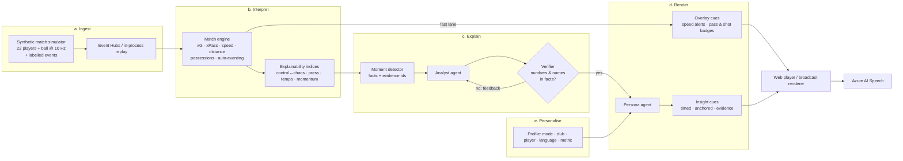

# Pitchside: the synthetic match insights engine

**An AI insights engine that explains the game beyond the stats.** Pitchside ingests a live stream of synthetic, football-realistic tracking and event data, turns it into statistics and patterns, explains *why* moments matter, renders that as timed broadcast overlays, and personalises the same intelligence for every viewer: a casual fan in Madrid following one striker, or a data-hungry analyst in London.

> All data is synthetic. Clubs, players, stadium and referee are fictional, and no real Premier League data is used or redistributed.

Built for the *Inside the Game* developer hackathon (Microsoft × Premier League).

## Elevator pitch

Studio and streaming teams have more data than airtime. Pitchside is a multi-agent system that watches every pass, sprint and press in real time. Deterministic analytics find the moments that matter, such as a team cranking up its press, a line-breaking pass, or the game tipping from control into chaos. A **Microsoft Agent Framework** workflow then turns each moment into a verified explanation. Every number and name the agents write is checked against the match data before it reaches the screen; ungrounded drafts are sent back with the exact problem, and fall back to a grounded template if they fail again. A persona agent rewrites each verified insight for the viewer's mode, club, focus player, language and favourite metric. The output is a timed, machine-readable overlay track that a broadcast renderer can consume, plus a live web experience with read-aloud through **Azure AI Speech**. It deploys to **Azure Container Apps** with **Azure OpenAI** (managed identity, no keys) and **Azure Event Hubs** for the live feed.

## The five-stage pipeline



| Brief stage | What Pitchside does | Where |
|---|---|---|
| **(a) Ingest** | Time-ordered stream of tracking frames and events, replayed live or delivered over Azure Event Hubs | `pitchside/stream.py`, `pitchside/bus.py` |
| **(b) Interpret** | Team and player stats, xG, an xPass model trained on 42k synthetic passes, ball and shot speed from tracking, distance, sprints, possession sequences | `pitchside/intel/` |
| **(c) Explain** | Rolling indices (control vs chaos, press intensity, tempo, momentum) as league percentiles; moment detection; Analyst agent with grounding verification | `intel/engine.py`, `agents/pipeline.py` |
| **(d) Render** | Two-lane overlay cues: a deterministic fast lane (sub-second) and an agent lane (verified narratives), all with `t_in`/`t_out`, anchor, priority and evidence ids | `/api/overlay-track`, `web/` |
| **(e) Personalise** | Casual vs analyst, favourite club framing, Player Focus mode (camera, card and story follow one player), 8 languages, metric of interest | `agents/pipeline.py`, `web/app.js` |

## Features against the brief

**Real-time match intelligence**
- **Player identification:** live name tags on the ball carrier and the focus player. Speed badges fire when a player crosses 30 km/h, and distance milestones fire for the focus player.
- **Pass quality:** distance, completion, and a **difficulty rating (0–100)** from a logistic xPass model. It uses pass length, opponents in the lane, pressure on the passer, marking on the receiver, opponents bypassed, and box entry. Trained on 42,037 synthetic passes; held-out AUC 0.70, well calibrated where most passes sit (see `data/model_report.json`).
- **Speed metrics:** ball speed and shot speed measured from the tracking stream, not from labels.
- **Auto-eventing (experimental):** possession and passes re-derived from raw tracking alone, using ball proximity, velocity matching and hysteresis, then scored against ground truth. It reaches 60% precision and 79% recall on possession changes within 5 s. Most of the gap is definitional, for example dead-ball possession timing. A video model is the natural next step: the tracking-to-events stage is already separate from the event labels.

**Narrative generation:** goals, with build-up story (how the move started, passes, duration, players involved, game state); big chances and saves; line-breaking passes; milestones; long possession spells; top-speed records; half-time and full-time recaps with player of the match and a social post.

**Explainability:** every insight answers *why*:
- **Control ↔ Chaos:** turnover rate and passes per possession over the last 5 minutes, as a percentile of a synthetic league baseline (30 matches).
- **Press intensity:** pressures per minute, press height and PPDA, compared with the previous 5 minutes. This detects real tactical shifts: the simulator changes press intensity with game state, and those hidden ground-truth changes are what the detector finds.
- **Rhythm:** tempo (passes per minute in possession) and directness.
- **Momentum:** threat balance from xG and final-third entries.
- In the UI, every card has **"Why? Show the evidence"**, which lists the facts table, the raw events behind the insight, and the verification checks.

**Data innovation:** an agent-based simulator generates a full 90-minute match (about 58k frames and about 2.6k events) in roughly 12 s. Players have formation shapes, marking, pressing triggers, speed and acceleration limits, fatigue and set pieces, and tactics react to the score. Realism checks across 30 seeds: 79% pass completion, about 27 shots and 3.8 goals per match, 11–12.5 km per outfield player, top speeds of 27–31 km/h.

**Multi-language storytelling:** the persona agent writes natively in English, Spanish, French, Portuguese, German, Arabic, Hindi and Japanese. Numbers and names are verified in every language. Read-aloud uses Azure AI Speech neural voices when configured, and the browser voice otherwise.

## Agentic design

- **Microsoft Agent Framework workflow** (`WorkflowBuilder`): Analyst → Verifier → Persona, with a conditional **feedback edge** from Verifier back to Analyst. The Persona stage fans out to every active audience profile concurrently.
- **Grounding over trust.** The Verifier is deterministic. Every number (including ordinals and decimal commas) and every player or club name must appear in that moment's `facts`. On failure, the exact problems go back to the agent ("number 27 is not in the facts"). A second failure falls back to a grounded template, so nothing unverified reaches air.
- **Two lanes for latency.** Physical and pass/shot overlays are deterministic and immediate. Narratives arrive a moment later through the agent lane. Each insight cue reports its latency.
- **Editorial relevance.** Casual viewers get high-importance moments only; analysts get everything; anything involving the focus player always gets through.
- **Deterministic replays.** Model responses are cached by prompt hash, so a seeded match replays identically and cheaply, which helps demos and rate-limited tiers.
- **Pluggable models.** `PITCHSIDE_LLM=azure | foundry_local | github | openai | offline`. Offline mode needs no keys and is fully functional (templates in English and Spanish).

## Run it

```bash
python3.12 -m venv .venv && source .venv/bin/activate
pip install -r requirements-dev.txt
uvicorn pitchside.server:app --port 8000     # open http://localhost:8000
pytest -q                                    # 25 tests
```

To use a model, copy `.env.example`, set `PITCHSIDE_LLM`, and export the variables. For example, on-device with [Foundry Local](https://learn.microsoft.com/azure/ai-foundry/foundry-local/):

```bash
foundry model run phi-4-mini
export PITCHSIDE_LLM=foundry_local FOUNDRY_LOCAL_ENDPOINT=http://localhost:5273/v1
```

Other entry points:

```bash
python -m pitchside.sim --seed 4 7 11              # generate matches into data/
python scripts/build_models.py --matches 30         # retrain xPass + league baselines
curl "localhost:8000/api/overlay-track?mode=analyst&language=es"   # full-match overlay track
python -m pitchside.bus publish --seed 4            # stream a match onto Event Hubs
python -m pitchside.bus consume                     # ingest from Event Hubs into the engine
```

## Deploy to Azure

```bash
azd up
```

`infra/main.bicep` provisions Container Apps, Azure OpenAI (gpt-4.1-mini, called with a managed identity), AI Speech (F0), Event Hubs (Basic), Container Registry and Log Analytics. The app scales to zero when idle.

## Overlay cue format (`pitchside.overlay/v1`)

```json
{
  "id": "m12:analyst|home|H09|es|-", "lane": "agent", "type": "insight", "kind": "press_shift",
  "t_in": 3346.1, "t_out": 3354.1, "clock": "55:46", "priority": 2,
  "anchor": {"screen": "lower_third"}, "language": "es",
  "overlay": "Kingsmoor FC adelanta la presión",
  "line": "Las presiones pasan de 3.0 a 6.4 por minuto y el PPDA baja de 16.0 a 5.0 …",
  "verified": true, "evidence_ids": [2011, 2019, 2034],
  "facts": {"pressures_per_min_now": 6.4, "ppda_now": 5.0, "...": "..."}
}
```

Fast-lane cues (`speed_alert`, `pass_badge`, `shot_badge`, `card`, `distance_milestone`) share the same envelope, with a `payload` and a player `anchor`.

## Project layout

```
pitchside/
  sim/        agent-based match simulator, fictional clubs and squads
  intel/      engine: stats, xPass, tracking metrics, auto-eventing, indices, moments
  agents/     Agent Framework workflow, grounding verifier, model providers, offline templates
  server.py   FastAPI + WebSocket live sessions, overlay track, evidence and TTS endpoints
  bus.py      Azure Event Hubs publisher and consumer
web/          broadcast-style player (vanilla JS + canvas)
infra/        Bicep for azd
scripts/      model training and league baselines
tests/        25 tests: determinism, realism, engine, grounding, agent loop, server
```

## Honest limitations

- The simulator is football-realistic, not football-perfect: it scores a little more often than real matches, and strikers take a large share of shots.
- Auto-eventing works from tracking, not video; precision is moderate (see above).
- Offline templates cover English and Spanish; the other languages need a model provider.

## Licence

MIT
